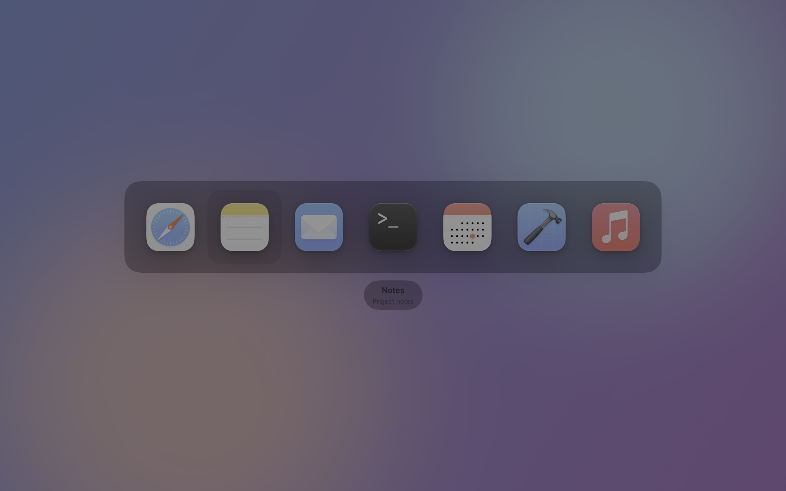
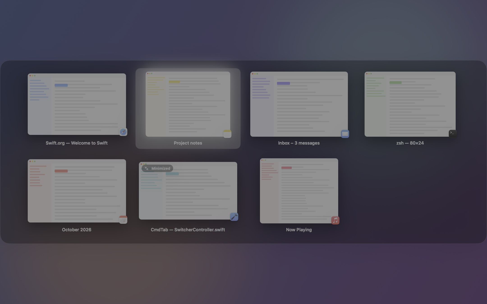
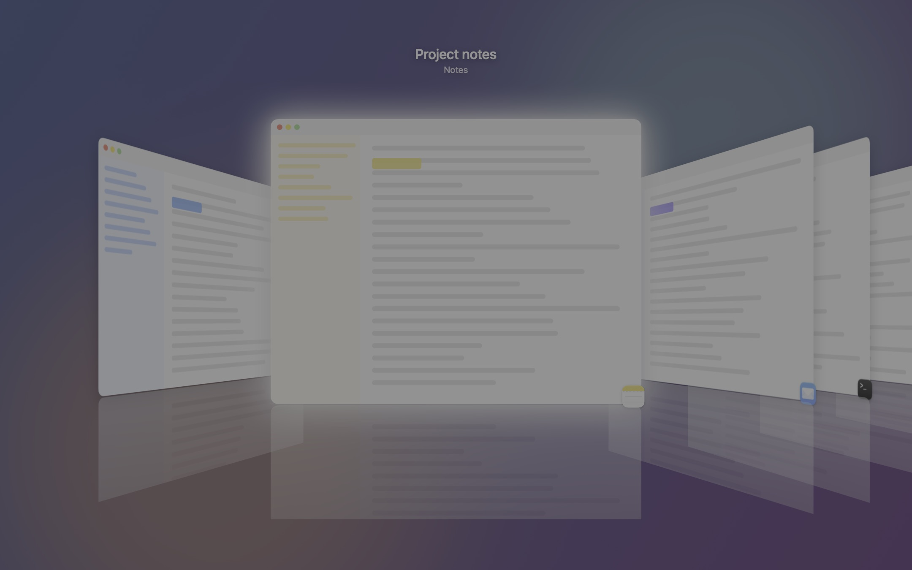
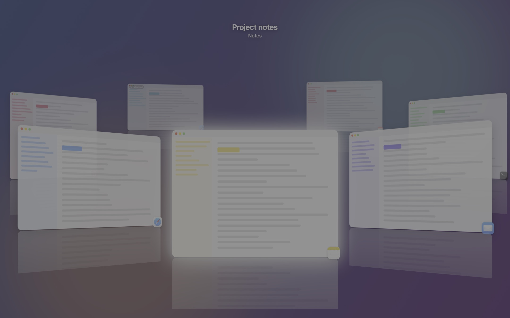
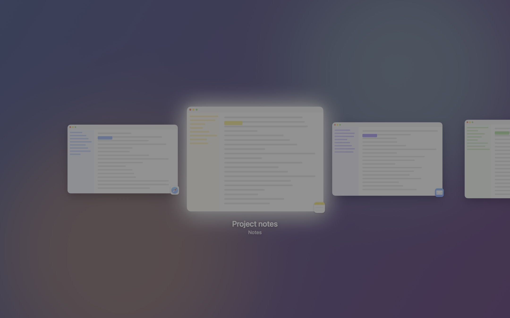
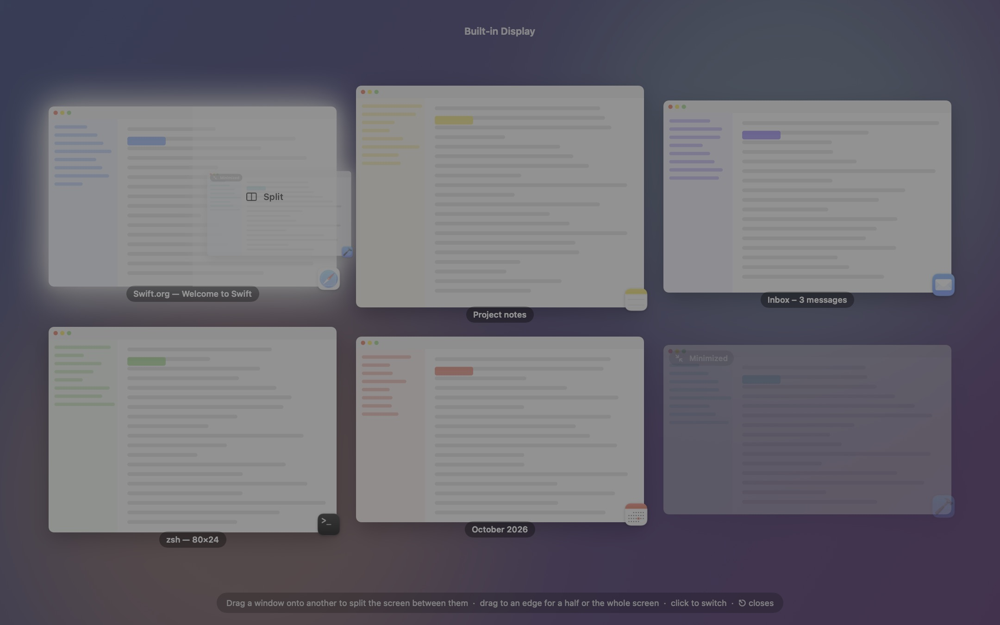

# CmdTab

A small, native macOS window switcher. It replaces ⌘⇥ (or any shortcut you pick), can list every window instead of just apps, comes with five animated styles, and replaces Mission Control with an Exposé you can arrange windows in by dragging.

Requires macOS 26 or newer. Written in Swift with AppKit + SwiftUI, no dependencies.

## Screenshots

Rendered from synthetic windows with `CmdTab --screenshots <dir>`, so they show the layouts rather than anyone's desktop.

| Classic | Grid |
| --- | --- |
|  |  |

| Cover Flow | Ring |
| --- | --- |
|  |  |

| Filmstrip | Exposé (dragging a window onto another) |
| --- | --- |
|  |  |

## Features

- **Any shortcut**, including ⌘⇥ itself. Hold the modifier and tap the key to cycle, add ⇧ to go back, release the modifier to switch. A quick tap jumps straight to the previous window without showing the UI.
- **Second shortcut** (default ⌘`) for the windows of the current app only. Pressing it while ⌘⇥ is open switches scope on the fly.
- **Windows or apps.** "Show every window" gives each Chrome window (or any other app's window) its own entry. App mode groups like the system switcher and also lists apps without windows.
- **Five styles**, all spring-animated: Classic (row of icons like macOS), Grid (previews in a grid), Cover Flow (3D carousel), Ring (windows on a spinning 3D ring), Filmstrip (one line of previews). The selected preview is marked with a soft glow.
- **Live previews** of every window via ScreenCaptureKit, including minimized windows and windows on other Spaces.
- **Mouse:** in Classic and Grid hovering selects; in the moving styles a click selects. The switcher stays open while the modifier is held; clicking the highlighted window or releasing the modifier switches. Click outside cancels.
- **Keys while open:** ←/→/↑/↓ move, ↩ switch, ⎋ cancel, W close window, M minimize, Q quit app.
- **Exposé on the Mission Control key (F3).** Every window of every display spread out, one overlay per display. Drag a window onto another to split the screen between them (the half it lands in lights up), drag to the left or right edge for that half, to the top edge to fill the screen, or onto another display to move it there. The overview reflows after each change so you can keep arranging. Click a window to switch to it, arrows and ↩ work too, ⎋ closes. Arranging uses Accessibility, so it works on any app's windows.
- **Multiple displays:** choose where the switcher appears (display under the mouse by default, the active window's display, or the primary one) and whether it lists windows from all displays or only its own.
- Menu bar item with quick style switching (can be hidden; open the app again to reach Settings), launch at login, a Preview button in Settings.
- A permissions window gates startup: nothing runs until Accessibility and Screen Recording are granted.

## License

MIT, see `LICENSE`.

## Build

```bash
./build.sh
```

That renders the app icon, generates `CmdTab.xcodeproj` with [xcodegen](https://github.com/yonaslab/XcodeGen) and builds into `build/CmdTab.app`. Or open the generated project in Xcode. Signing uses the "Apple Development" identity on this Mac; keep the signing identity stable, otherwise macOS forgets the permissions after every rebuild.

Copy `build/CmdTab.app` to `/Applications` for day-to-day use (launch at login expects a stable location).

## Permissions

CmdTab needs two grants in System Settings → Privacy & Security:

- **Accessibility** to intercept the shortcut before the system does and to raise windows.
- **Screen Recording** for window previews and titles. Without it the switcher still works with app icons.

The Settings window shows the state of both and opens the right pane. Relaunch after granting Screen Recording.

## Privacy

CmdTab runs entirely on your Mac. It makes no network connections, has no analytics, no accounts and no third-party code. The two permissions are used only for what the switcher shows: Screen Recording to read window titles and render previews, Accessibility to intercept the shortcut and raise windows. Previews live in memory while the app runs and are never written to disk. The only thing stored is your settings, in the app's own preferences.

## Private APIs

Three private system calls are used: `_AXUIElementGetWindow` to match Accessibility windows to window numbers, and the SkyLight calls `_SLPSSetFrontProcessWithOptions` and `SLPSPostEventRecordTo` to focus a specific window of another app, since the public activation API is cooperative since macOS 14 and refuses background apps. They are looked up at runtime in `Core/PrivateAPI.swift`; if a macOS release removes one, switching falls back to the public path (less precise about which window gets focus) instead of the app failing to launch. Together with the lack of sandboxing they rule out the Mac App Store; direct distribution with notarization is unaffected.

## How it works

- `Input/EventTap.swift` installs a session-level `CGEventTap`; `Switcher/SwitcherController.swift` is the state machine (open, cycle, commit on modifier release).
- `Core/WindowSource.swift` enumerates windows with `SCShareableContent` and cross-checks them against each app's Accessibility window list (`Core/AXWindowCache.swift`), which also provides the minimized state.
- `Core/ThumbnailStore.swift` captures previews with `SCScreenshotManager`, a few at a time.
- `Core/WindowActivator.swift` focuses the chosen window with the SkyLight calls above when available, then raises it via Accessibility.
- `Switcher/Styles/*` are plain SwiftUI views hosted in a borderless non-activating `NSPanel`.
- `Expose/*` is the Mission Control replacement: `ExposeLayout.swift` packs windows into rows at one scale, `ExposeController.swift` owns the per-display panels and turns drops into window frames, and `Core/WindowArranger.swift` applies them through Accessibility.
